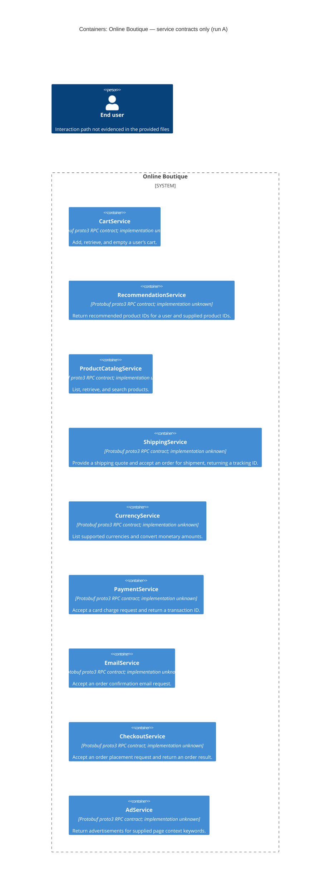

# Architecture recovery — run A

## Agent

OpenAI Codex. Exact model identifier unavailable.

## Files read

- `prompts/1-recover-architecture.md`
- `system/online-boutique/protos/demo.proto`

Repository instructions were supplied in the conversation; no additional repository files were opened.

## Containers table

The evidence declares nine service interfaces. These are represented below as candidate service containers; independent deployment and the mapping of interfaces to running containers are **Not evidenced in the provided files**. Responsibilities describe the declared APIs, not verified implementation behavior. All interfaces use Protocol Buffers `proto3` (`system/online-boutique/protos/demo.proto:15`); implementation languages are **Not evidenced in the provided files**. The `go_package` option (line 19) identifies a Go package target, not every service’s implementation language.

| Name | Technology/language | Responsibility | Evidence |
| --- | --- | --- | --- |
| CartService | Protocol Buffers proto3 RPC contract; implementation language unknown. | Add, retrieve, and empty a user’s cart. | `system/online-boutique/protos/demo.proto:23–27` (`CartService`: AddItem, GetCart, EmptyCart) |
| RecommendationService | Protocol Buffers proto3 RPC contract; implementation language unknown. | Return recommended product IDs for a user and supplied product IDs. | `system/online-boutique/protos/demo.proto:56–67` (`RecommendationService`: ListRecommendations) |
| ProductCatalogService | Protocol Buffers proto3 RPC contract; implementation language unknown. | List, retrieve, and search products. | `system/online-boutique/protos/demo.proto:71–75` (`ProductCatalogService`: ListProducts, GetProduct, SearchProducts) |
| ShippingService | Protocol Buffers proto3 RPC contract; implementation language unknown. | Provide a shipping quote and accept an order for shipment, returning a tracking ID. | `system/online-boutique/protos/demo.proto:107–128` (`ShippingService`: GetQuote, ShipOrder) |
| CurrencyService | Protocol Buffers proto3 RPC contract; implementation language unknown. | List supported currencies and convert monetary amounts. | `system/online-boutique/protos/demo.proto:140–143` (`CurrencyService`: GetSupportedCurrencies, Convert) |
| PaymentService | Protocol Buffers proto3 RPC contract; implementation language unknown. | Accept a card charge request and return a transaction ID. | `system/online-boutique/protos/demo.proto:177–195` (`PaymentService`: Charge) |
| EmailService | Protocol Buffers proto3 RPC contract; implementation language unknown. | Accept an order confirmation email request. | `system/online-boutique/protos/demo.proto:199–201, 216–219` (`EmailService`: SendOrderConfirmation) |
| CheckoutService | Protocol Buffers proto3 RPC contract; implementation language unknown. | Accept an order placement request and return an order result. | `system/online-boutique/protos/demo.proto:224–239` (`CheckoutService`: PlaceOrder) |
| AdService | Protocol Buffers proto3 RPC contract; implementation language unknown. | Return advertisements for supplied page context keywords. | `system/online-boutique/protos/demo.proto:243–261` (`AdService`: GetAds) |

## Dependencies table

No runtime caller → callee dependency is evidenced. An RPC declaration identifies a callable interface, but does not identify its callers, deployed transport, or whether it is invoked. Shared message types do not establish runtime service dependencies.

| Caller → callee | Protocol | Evidence |
| --- | --- | --- |

There are no evidenced dependency rows. For example, `PlaceOrderRequest` includes an address, email, and credit card (`system/online-boutique/protos/demo.proto:228–235`), but this does not prove that `CheckoutService` calls `ShippingService`, `EmailService`, or `PaymentService`. Actual runtime protocol, including gRPC, is **Not evidenced in the provided files**.

## Mermaid diagram

The diagram contains exactly the nine service candidates in the containers table and no dependency relationships, matching the empty dependencies table. The required end-user symbol is contextual: `user_id` appears in request messages (e.g. `system/online-boutique/protos/demo.proto:34–36, 228–230`), but a human-facing entry point and interaction protocol are **Not evidenced in the provided files**. The system boundary follows the task’s Online Boutique scope; deployment boundaries remain unverified.

## Gaps

All items below are **Not evidenced in the provided files**. Suggested verification paths are requests for additional evidence; they were not opened and their existence was not verified.

| Gap | Extra file that would help settle it |
| --- | --- |
| Which interfaces run as separate containers; implementation language and startup command for each. | Corresponding deployment manifest and service Dockerfile, e.g. `system/online-boutique/kubernetes-manifests/cartservice.yaml` and `system/online-boutique/src/cartservice/Dockerfile`. Repeat for each declared service. |
| Runtime callers, callees, endpoints, and transport protocols. | Caller implementation and client setup, e.g. `system/online-boutique/src/checkoutservice/main.go`, plus its deployment manifest. Shared `OrderResult`, `Money`, or `CartItem` types alone cannot establish these edges (`system/online-boutique/protos/demo.proto:203–214, 146–161, 29–32`). |
| User-facing entry point, UI container, and browser protocol. | `system/online-boutique/kubernetes-manifests/frontend.yaml` and `system/online-boutique/src/frontend/main.go`; neither a frontend container nor a user dependency is established by this schema. |
| Data stores, persistence, or message brokers. | Storage configuration and implementation, e.g. `system/online-boutique/kubernetes-manifests/cartservice.yaml` and `system/online-boutique/src/cartservice/src/Startup.cs`. Cart messages (`system/online-boutique/protos/demo.proto:29–50`) define data shapes, not a database or durability guarantee. |
| External payment, shipping, or email systems and their integration protocols. | Provider implementations, e.g. `system/online-boutique/src/paymentservice/index.js`, `system/online-boutique/src/shippingservice/main.go`, and `system/online-boutique/src/emailservice/email_server.py`. API names alone do not establish external systems or real provider integrations (`system/online-boutique/protos/demo.proto:107–110, 177–179, 199–201`). |
| Checkout orchestration, transaction boundaries, failure handling, and architectural rationale. | `system/online-boutique/src/checkoutservice/main.go` for implemented behavior, and a relevant design document or ADR for rationale. `PlaceOrder` and its messages (`system/online-boutique/protos/demo.proto:224–239`) do not show an execution sequence or quality guarantees. |
